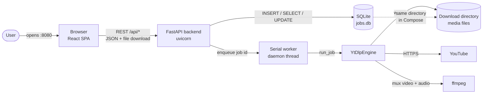
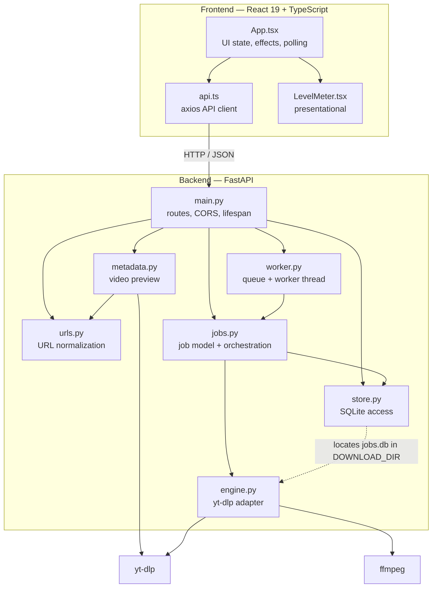
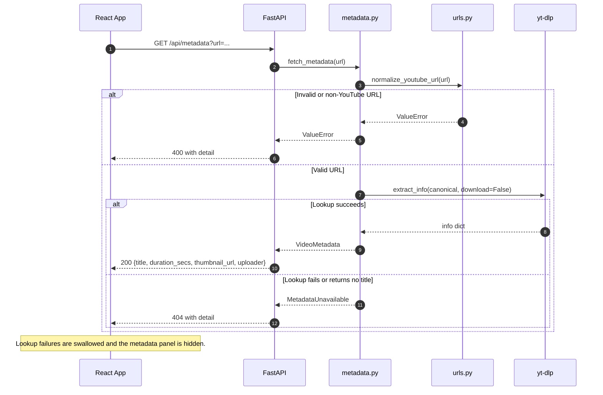
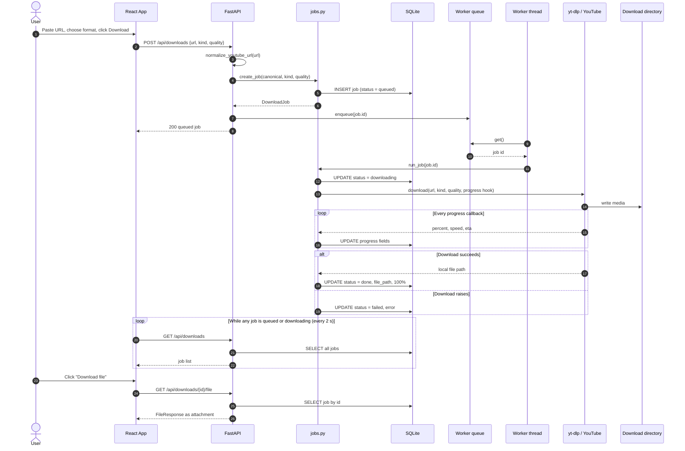
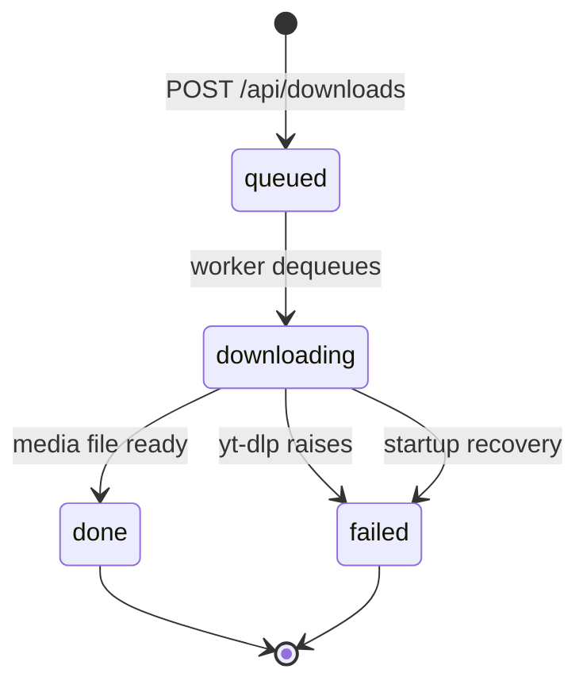
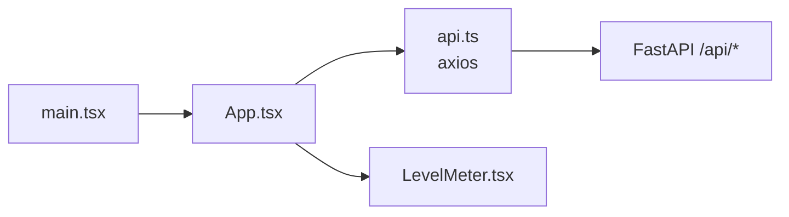
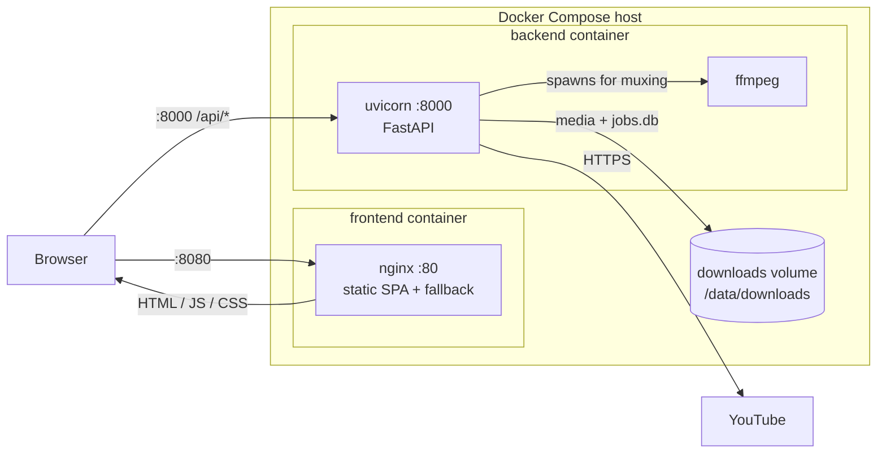

# Architecture

`ytb-downloader` is a small, self-hosted YouTube downloader: a React single-page
app talks to a FastAPI backend, which runs `yt-dlp` in a single background worker
and stores job state in SQLite. It is designed as a single-user local tool, not a
multi-tenant service.

This document describes the current implementation on `main`: the components,
how a request flows through them, how job state is persisted, and the deployment
topology.

## Contents

- [At a glance](#at-a-glance)
- [System context](#system-context)
- [Repository layout](#repository-layout)
- [Backend architecture](#backend-architecture)
- [End-to-end flows](#end-to-end-flows)
- [Job model and lifecycle](#job-model-and-lifecycle)
- [Persistence](#persistence)
- [Download engine and format selection](#download-engine-and-format-selection)
- [URL validation](#url-validation)
- [HTTP API](#http-api)
- [Frontend architecture](#frontend-architecture)
- [Deployment](#deployment)
- [Testing and CI](#testing-and-ci)
- [Design decisions and trade-offs](#design-decisions-and-trade-offs)
- [Operational limits](#operational-limits)
- [Extending the system](#extending-the-system)

## At a glance

| Layer | Technology | Responsibility |
| --- | --- | --- |
| Frontend | React 19, TypeScript, Vite 8, Tailwind CSS 4, axios | Paste a URL, preview metadata, submit downloads, poll and display the queue |
| Backend | Python 3.12, FastAPI, uvicorn, Pydantic | Validate requests, expose REST endpoints, orchestrate jobs, serve finished files |
| Download engine | `yt-dlp` + `ffmpeg` | Resolve formats, download media, merge video + audio |
| Persistence | SQLite (`jobs.db`) + filesystem | Durable job records and downloaded media |
| Packaging | Docker Compose, nginx | Static frontend container and backend container sharing a downloads volume |

The defining design choices are:

- **REST + polling, no push channel.** The browser polls the job list every two
  seconds while anything is queued or downloading.
- **One serial worker.** Downloads run one at a time in a daemon thread inside
  the API process.
- **SQLite is the source of truth.** In-memory job objects cache and reuse state,
  but every job read goes back to the database.
- **Validate at the edge.** Only canonical YouTube video URLs are accepted; the
  canonical form is what gets persisted and passed to `yt-dlp`.
- **Blocking work stays out of the event loop.** FastAPI's synchronous route
  handlers run in its thread pool, and the actual download runs in a dedicated
  worker thread.

## System context



The browser talks to the API directly. In the Docker setup nginx only serves the
built frontend on port 8080; API calls go cross-origin to port 8000, which is why
the backend has an explicit CORS allow list. There is no reverse proxy or
same-origin API path.

## Repository layout

```text
.
├── backend/
│   ├── app/
│   │   ├── main.py        FastAPI app, routes, CORS, lifespan
│   │   ├── urls.py        YouTube URL parsing and canonicalization
│   │   ├── metadata.py    Preview lookup through yt-dlp (no download)
│   │   ├── jobs.py        Job models, cache, create/get/list, run_job
│   │   ├── worker.py      In-memory queue + one background thread
│   │   ├── engine.py      yt-dlp adapter, format selection, progress hooks
│   │   └── store.py       SQLite schema and CRUD
│   ├── tests/             pytest suite with a fake download engine
│   ├── Dockerfile         python:3.12-slim + ffmpeg + uv
│   └── pyproject.toml
├── frontend/
│   ├── src/
│   │   ├── App.tsx        All UI state, effects, form and queue rendering
│   │   ├── api.ts         Typed axios wrappers around the API
│   │   ├── components/LevelMeter.tsx
│   │   ├── index.css      Tailwind entry + theme variables
│   │   └── main.tsx
│   ├── nginx.conf         SPA fallback + asset caching
│   ├── Dockerfile         Vite build stage → nginx runtime stage
│   └── package.json
├── docker-compose.yml
├── .github/workflows/ci.yml
└── ARCHITECTURE.md
```

## Backend architecture

### Modules and responsibilities

| Module | Responsibility | Key symbols |
| --- | --- | --- |
| `app/main.py` | HTTP surface, CORS, application lifespan | `app`, `lifespan`, `post_download`, `get_download_file` |
| `app/urls.py` | Accept only YouTube video URLs and reduce them to a canonical watch URL | `normalize_youtube_url` |
| `app/metadata.py` | Fetch title, duration, thumbnail, uploader without downloading | `fetch_metadata`, `VideoMetadata` |
| `app/jobs.py` | Job models and lifecycle, in-memory cache, engine invocation, progress persistence | `DownloadJob`, `create_job`, `run_job`, `recover_incomplete` |
| `app/worker.py` | Process-local FIFO queue and the single worker thread | `enqueue`, `start_worker`, `stop_worker`, `wait_for` |
| `app/store.py` | SQLite schema and CRUD; no ORM, no migrations | `insert_job`, `get_job`, `list_jobs`, `mark_downloading_failed` |
| `app/engine.py` | `yt-dlp` integration, format strings, progress translation | `YtDlpEngine`, `format_for`, `Downloader` protocol |

Dependency direction is intentionally shallow:

- `main` depends on `jobs`, `worker`, `metadata`, `urls`, and `store`.
- `worker` depends on `jobs`.
- `jobs` depends on `store`, and imports `YtDlpEngine` lazily inside `run_job`.
- `store` imports `DOWNLOAD_DIR` from `engine` lazily to avoid import cycles.
- `engine` is isolated behind a `Downloader` protocol so tests can substitute a
  fake engine.

### Component diagram



### Startup and shutdown

`app.main.lifespan` wraps the whole application lifecycle:

1. Create `DOWNLOAD_DIR` if it does not exist.
2. Call `recover_incomplete()`, which marks any job left in `downloading` as
   `failed` with the message `server restarted while downloading`.
3. Start the single worker thread.
4. Serve requests.
5. On shutdown, enqueue a sentinel and join the worker thread.

Because the sentinel is queued behind any in-progress download, a graceful
shutdown waits for the current download to finish. Crash recovery is handled by
step 2 on the next startup.

### Request handling model

FastAPI route handlers are declared as regular `def` functions, so FastAPI runs
them in its worker thread pool instead of on the event loop. The download itself
runs on one additional background thread. Each SQLite operation opens a new
connection, and the `with` block manages the transaction (commit or rollback);
connections are not pooled.

The queue lives in process memory. The application is therefore designed to run
as **one uvicorn process**; multiple API workers would each have their own queue
and their own startup recovery pass.

## End-to-end flows

### 1. Metadata preview

When the URL field loses focus, the frontend calls `GET /api/metadata?url=...`.
The backend normalizes the URL, asks `yt-dlp` for information only
(`download=False`), and maps the result to a small view model.



The preview is advisory only. It does not reserve an ID or create a job.

### 2. Submitting and running a download



The POST response is the freshly created job, not the result of the download.
Completion is discovered through polling.

### 3. Progress and queue updates

`YtDlpEngine` installs a progress hook. For each `downloading` event it computes
a percentage from `downloaded_bytes` and `total_bytes` (or the estimated total),
then forwards percentage, speed, and ETA. On `finished` it reports 100%.

`run_job` writes those values to the job object and to SQLite on every callback.
The browser reads them through `GET /api/downloads` every two seconds while at
least one job is `queued` or `downloading`. The UI currently renders the
percentage (and status); speed and ETA are persisted and returned by the API but
are not displayed yet.

### 4. Serving the finished file

`GET /api/downloads/{job_id}/file` looks up the job and requires:

- the job exists, otherwise `404`;
- the job status is `done` and it has a `file_path`, otherwise `409`;
- the path still points to a regular file, otherwise `404`.

It then returns a Starlette `FileResponse` with the filename as an attachment.
Starlette handles RFC 5987 encoding for non-ASCII names, which is covered by a
backend test with a Japanese and full-width-quoted filename.

## Job model and lifecycle

### Fields

| Field | Type | Notes |
| --- | --- | --- |
| `id` | `str` | `uuid4().hex`, no dashes |
| `url` | `str` | Canonical `https://www.youtube.com/watch?v=<11-char id>` |
| `kind` | `video` \| `audio` | Defaults are not assumed; required on create |
| `quality` | `best` \| `1080p` \| `720p` \| `480p` | Defaults to `best`; ignored for audio |
| `status` | `queued` \| `downloading` \| `done` \| `failed` | See state machine |
| `error` | `str \| None` | Error text from the engine or restart recovery |
| `file_path` | `str \| None` | Absolute server-side path to the finished file |
| `progress_percent` | `float \| None` | 0–100 while downloading, 100 on success |
| `speed_bps` | `float \| None` | Bytes per second reported by `yt-dlp` |
| `eta_secs` | `float \| None` | Seconds remaining reported by `yt-dlp` |

### State machine



Transitions are persisted immediately. A failed job is terminal; the user can
submit the same URL again to create a new job. There is no retry, cancel, pause,
or delete operation.

### Restart semantics

- Jobs in `downloading` become `failed` with
  `server restarted while downloading`.
- Jobs already `done` or `failed` are untouched.
- Jobs in `queued` stay `queued` in SQLite, but they are **not re-enqueued**.
  The in-memory queue is empty after a restart, so no worker will pick them up.
  They remain visible as queued until manually resubmitted or cleared from the
  database.

## Persistence

### Schema

`store.py` creates one table lazily on every connection:

```sql
CREATE TABLE IF NOT EXISTS jobs (
    id TEXT PRIMARY KEY,
    url TEXT NOT NULL,
    kind TEXT NOT NULL,
    quality TEXT NOT NULL,
    status TEXT NOT NULL,
    error TEXT,
    file_path TEXT,
    progress_percent REAL,
    speed_bps REAL,
    eta_secs REAL
);
```

There are no migrations, timestamps, indexes beyond the primary key, or foreign
keys.

### Database location

```python
DOWNLOAD_DIR = Path(os.environ.get("YTB_DOWNLOAD_DIR", "./downloads"))

def db_path() -> Path:
    return DOWNLOAD_DIR / "jobs.db"
```

Job records live next to the downloaded media. In Docker, both are on the
`downloads` volume at `/data/downloads`, so restarting or recreating the
container preserves both the queue history and the files.

### Access pattern

- Every operation opens a new `sqlite3` connection; the `with` block handles
  commit or rollback, and connections are not pooled.
- `INSERT OR REPLACE` is used for both creation and every save.
- Reads always go to SQLite; the `_jobs` dictionary is a cache that preserves
  object identity and supports a test-only `clear()` hook.
- `list_jobs()` orders by `rowid DESC`, intended as newest first. Because
  `INSERT OR REPLACE` deletes and reinserts a row, saving progress assigns a new
  rowid. In practice the list orders by **last write**, not creation time. There
  is no `created_at` column to correct for that.

## Download engine and format selection

`format_for(kind, quality)` maps user choices to `yt-dlp` format selectors:

| Request | Format selector |
| --- | --- |
| Audio (any quality) | `ba[ext=m4a]/ba` |
| Video `best` | `bv*[ext=mp4]+ba[ext=m4a]/b[ext=mp4]/b` |
| Video `1080p` | `bv*[ext=mp4][height<=1080]+ba[ext=m4a]/b[ext=mp4][height<=1080]/b[height<=1080]/b` |
| Video `720p` | `bv*[ext=mp4][height<=720]+ba[ext=m4a]/b[ext=mp4][height<=720]/b[height<=720]/b` |
| Video `480p` | `bv*[ext=mp4][height<=480]+ba[ext=m4a]/b[ext=mp4][height<=480]/b[height<=480]/b` |

Each selector prefers separate MP4 video plus M4A audio, falls back to a
combined MP4 stream under the requested height, and finally to any available
stream. Video jobs set `merge_output_format = "mp4"`; `ffmpeg` must be installed
for merging.

`yt-dlp` options are deliberately minimal:

- `outtmpl`: `DOWNLOAD_DIR/%(title)s [%(id)s].%(ext)s`
- `noplaylist`: one video per job
- `format`: selector from the table
- `progress_hooks`: the adapter into `run_job`

After extraction, the engine resolves the output path with
`ydl.prepare_filename(info)`. If that extension no longer exists after muxing, it
falls back to the same stem with `.mp4`, and finally returns the original path.

## URL validation

`normalize_youtube_url` is the boundary guard for both previews and downloads.
It accepts:

- `youtube.com`, `www.youtube.com`, `m.youtube.com`, `music.youtube.com`
- `youtu.be`, `www.youtu.be`
- `/watch?v=<id>`, `/shorts/<id>`, and short-link `/<id>` forms

It rejects empty input, malformed URLs, non-YouTube hosts, unsupported paths,
and IDs that are not exactly 11 characters of `[A-Za-z0-9_-]`. Every accepted
form is reduced to:

```text
https://www.youtube.com/watch?v=<video_id>
```

Query parameters such as playlists and timestamps are discarded. This keeps
stored URLs clean and prevents the backend from being used as a general-purpose
URL fetcher.

## HTTP API

| Method | Path | Purpose | Success | Errors |
| --- | --- | --- | --- | --- |
| `GET` | `/api/health` | Liveness check | `200 {"status":"ok"}` | — |
| `POST` | `/api/downloads` | Validate URL and enqueue a job | `200` with the queued job | `400` invalid URL, `422` invalid body |
| `GET` | `/api/downloads` | List all jobs, newest write first | `200` array of jobs | — |
| `GET` | `/api/downloads/{job_id}` | Fetch one job | `200` job | `404` unknown ID |
| `GET` | `/api/downloads/{job_id}/file` | Download the finished file | `200` file attachment | `404` unknown job/file, `409` not ready |
| `GET` | `/api/metadata?url=...` | Preview video metadata | `200` metadata | `400` invalid URL, `404` unavailable |

### Create request and response

```json
{
  "url": "https://youtu.be/dQw4w9WgXcQ",
  "kind": "video",
  "quality": "1080p"
}
```

```json
{
  "id": "5f0c1c9d8a2e4b6f9c3d1e2a4b5c6d7e",
  "url": "https://www.youtube.com/watch?v=dQw4w9WgXcQ",
  "kind": "video",
  "quality": "1080p",
  "status": "queued",
  "error": null,
  "file_path": null,
  "progress_percent": null,
  "speed_bps": null,
  "eta_secs": null
}
```

### Metadata response

```json
{
  "title": "Never Gonna Give You Up",
  "duration_secs": 212,
  "thumbnail_url": "https://i.ytimg.com/vi/dQw4w9WgXcQ/hqdefault.jpg",
  "uploader": "Rick Astley"
}
```

Validation errors from Pydantic (for example an unknown `kind` or `quality`)
produce FastAPI's standard `422` response. Route-level URL errors are converted
to `400` with a human-readable `detail`.

## Frontend architecture

The frontend is intentionally small: one page component, one API module, one
presentational component.



### Responsibilities

- `api.ts` owns the base URL, request shapes, TypeScript types, and the file URL
  helper. `API_BASE` comes from `import.meta.env.VITE_API_BASE`, defaulting to
  `http://localhost:8000`.
- `App.tsx` owns all application state and effects. There is no router, global
  store, or data-fetching library.
- `LevelMeter.tsx` is a pure progress display: 16 discrete cells, ARIA
  `progressbar` semantics, and a tone per job status.

### State and effects

| State | Purpose |
| --- | --- |
| `connection` | `checking`, `connected`, or `disconnected`, set by one health request on mount |
| `url`, `kind`, `quality` | Controlled form fields |
| `job` | The most recently created job, shown as a readout |
| `jobs` | The full queue from `GET /api/downloads` |
| `listLoaded` | Distinguishes "not loaded yet" from "empty queue" |
| `error` | Submission error text |
| `submitting` | Disables the submit button during the POST |
| `metadata` | Preview result for the current URL |

Effects on mount:

1. `getHealth()` sets the connection lamp. It is checked once; there is no
   reconnect loop.
2. `getDownloads()` loads the initial queue.

A third effect derives `hasActive` from the queue. When any job is `queued` or
`downloading`, it starts a two-second interval that refreshes the whole list.
When the last active job finishes, the effect cleanup clears the interval.

On URL blur, `getMetadata` runs and either sets or clears the preview. On submit,
`createDownload` posts the form, sets the latest job, and refreshes the list,
falling back to prepending the created job if the refresh fails. Axios errors are
mapped to the backend's `detail` when it is a string, to a connection message when
there is no response, and to a generic failure otherwise.

### Visual system

Tailwind CSS 4 is wired through the Vite plugin. Theme colors are CSS custom
properties defined in `index.css` (`--plate`, `--glass`, `--ink`, `--frost`,
`--amber`, `--mint`, `--ember`), producing an instrument-panel look. Status tones
map to those variables: queued is dim frost, active is amber, done is mint, and
failed is ember.

### Contract gap

The backend job object includes `quality`, `speed_bps`, and `eta_secs`, but the
frontend `DownloadJob` type only declares the fields it uses. The API response is
a superset and remains compatible, but new UI fields need a type update in
`api.ts`.

## Deployment



### Services

| Service | Image/build | Port | Notes |
| --- | --- | --- | --- |
| `frontend` | Multi-stage `node:20-alpine` → `nginx:alpine` | `${FRONTEND_PORT:-8080}:80` | Serves the Vite build; SPA fallback to `index.html`; hashed assets cached for a year |
| `backend` | `python:3.12-slim`, `uv`, `ffmpeg`, `curl` | `${BACKEND_PORT:-8000}:8000` | Runs one uvicorn process; healthcheck calls `/api/health`; restarts unless stopped |
| `downloads` | Named volume | — | Mounted at `/data/downloads`; holds media and `jobs.db` |

`depends_on` only waits for the backend container to start, not for its
healthcheck. The frontend is static and does not need the API at build or start
time, so this is sufficient.

### Configuration

| Variable | Consumed by | Default | Notes |
| --- | --- | --- | --- |
| `YTB_DOWNLOAD_DIR` | Backend (`engine.py`) | `./downloads` | Where media and `jobs.db` live; `/data/downloads` in Compose |
| `CORS_ORIGINS` | Backend (`main.py`) | `http://localhost:5173`, `http://127.0.0.1:5173` | Comma-separated allow list; Compose defaults it to `FRONTEND_PORT` plus the dev origin on 5173 |
| `VITE_API_BASE` | Frontend at **build time** | `http://localhost:8000` | Baked into the bundle; Compose defaults it to `BACKEND_PORT`; changing it requires a rebuild |
| `BACKEND_PORT` | Docker Compose | `8000` | Host port published for the backend; feeds the default `VITE_API_BASE` |
| `FRONTEND_PORT` | Docker Compose | `8080` | Host port published for the frontend; feeds the default `CORS_ORIGINS` |

### Local development

```sh
# Backend, from backend/
uv run uvicorn app.main:app --reload

# Frontend, from frontend/
npm install
npm run dev
```

Vite serves on `http://localhost:5173`; the backend listens on
`http://localhost:8000`. Both origins are allowed by the development CORS
default. To use a different API origin, rebuild with `VITE_API_BASE`.

### Container build details

- The backend image installs `ffmpeg` and `curl`, copies only
  `pyproject.toml` and `uv.lock`, runs `uv sync --locked --no-dev
  --no-install-project`, then copies `app/`. It declares a volume and a
  healthcheck, and runs uvicorn on `0.0.0.0:8000`.
- The frontend image installs dependencies with `npm ci`, copies `index.html`,
  the Vite, TypeScript, Vitest, and Biome configs, plus `src/`, builds with the
  `VITE_API_BASE` build arg, then copies `dist/` and `nginx.conf` into nginx.

## Testing and CI

### Backend

The pytest suite uses FastAPI's `TestClient` and isolates every run from real
downloads:

- A session fixture points `DOWNLOAD_DIR` at a temporary directory.
- An autouse fixture substitutes `FakeEngine` for `YtDlpEngine`, writes fake
  bytes, and clears the in-memory cache plus the SQLite jobs table between
  tests.
- Real `yt-dlp` calls are monkeypatched in metadata tests with canned extractors.

Coverage by file:

| Test file | Focus |
| --- | --- |
| `test_health.py` | Health endpoint |
| `test_urls.py` | URL forms, canonicalization, rejections |
| `test_metadata.py` | Metadata mapping and unavailable-video handling |
| `test_quality.py` | Format selectors and quality validation |
| `test_downloads.py` | Create/list/get, transitions, file serving, Unicode filename, 404/409/422 paths |
| `test_progress.py` | Progress callback persistence |
| `test_persist.py` | SQLite round-trips, list ordering, restart recovery |
| `test_worker.py` | Strict serial execution of queued jobs |

`worker.wait_for` is a test synchronization helper. It waits on the condition
variable the worker notifies when a job finishes.

### Frontend

Vitest + Testing Library + jsdom render `App` with the `api.ts` module mocked.
Tests cover the health lamp, form submission, format/quality payloads, submission
errors, metadata on blur, queue rows, file links, and failed-job errors.

### CI

The GitHub Actions workflow runs on every pull request:

| Job | Steps |
| --- | --- |
| `backend-lint` | `ruff check .`, `ruff format --check .` |
| `backend-test` | `pytest` |
| `frontend-lint` | `npm ci`, `biome check --error-on-warnings .` |
| `frontend-build-test` | `npm ci`, `npm run build` (`tsc --noEmit` + Vite), `vitest run` |

Backend jobs use Python 3.12 via `setup-uv`; frontend jobs use Node 24. The
frontend Docker image uses Node 20, which satisfies the declared engine floor
but differs from CI.

## Design decisions and trade-offs

| Decision | Why | Consequence |
| --- | --- | --- |
| One serial worker thread | Predictable CPU, disk, and network usage; avoids concurrent `yt-dlp` processes competing for `ffmpeg` and bandwidth | One slow download delays everything behind it; throughput is one job at a time |
| In-process `queue.Queue` | Minimal moving parts; no broker to run | Queue is lost on restart; ties the app to a single process |
| SQLite with per-call connections | Zero external services; durable state across restarts; easy local development | No migrations or connection pooling; writes can contend under load |
| Save progress on every hook | The DB is always close to the live state, and polling sees fresh values | Frequent small writes; much finer granularity than the 2-second UI needs |
| REST polling | Simple, debuggable, works through proxies and static hosting | Up to two seconds of latency; repeated full-list requests |
| Sync FastAPI handlers | Straightforward blocking code for `yt-dlp`; FastAPI moves it off the event loop | Each metadata request occupies a thread while `yt-dlp` resolves it |
| YouTube URL allow list | Prevents arbitrary fetch/SSRF-style use and keeps stored URLs canonical | Only YouTube video URLs are supported |
| Build-time `VITE_API_BASE` | Frontend can be served as pure static files from any host | API URL changes require a rebuild |
| Separate frontend and API origins | Frontend and backend scale and deploy independently | CORS must be configured correctly; the backend must be browser-reachable |

## Operational limits

These are inherent in the current design, not bugs to discover later:

- **Single process only.** Do not run uvicorn with multiple workers. The queue,
  worker thread, and startup recovery are per process. A second process starting
  while the first is downloading can also mark that live job as failed during its
  own recovery pass.
- **Queued work is not durable.** A crash or restart loses the in-memory queue.
  Only `downloading` rows are reconciled; `queued` rows are left untouched.
- **No authentication, authorization, or TLS.** Anyone who can reach the API can
  create downloads, list history, and fetch files. Run it on a trusted network,
  or put an authenticating, TLS-terminating proxy in front of it.
- **No rate limiting.** Metadata preview and download creation can be called
  freely; each metadata call invokes `yt-dlp`.
- **No cancellation, retry, pause, or delete.** Failed jobs are terminal, and
  finished files are only removed outside the app.
- **No retention or cleanup.** The job table and download directory grow
  indefinitely. There is no pagination on the jobs list.
- **The cache is not lock-protected.** `_jobs` is a convenience cache; concurrent
  request threads could briefly observe objects being updated. SQLite remains
  authoritative and each read refreshes the fields, so correctness does not
  depend on the cache.
- **Health checking is one-shot on the client.** The frontend does not retry the
  health check, so the lamp stays disconnected if the backend starts later.
- **Long metadata calls are hidden.** The UI swallows preview failures and gives
  no feedback while a preview is in flight.
- **Disk and `ffmpeg` are hard requirements.** The backend cannot merge separate
  video and audio streams without `ffmpeg`, and the volume must be writable and
  persistent.

## Extending the system

Natural next steps, in rough order of architectural impact:

1. **Durable queue** — move job IDs into a broker or a `pending` table and let
   workers claim rows, so restarts and multiple processes are safe.
2. **Authentication and rate limiting** — required before exposing the service
   beyond a trusted network.
3. **Cancellation and retry** — add `canceled` state, cooperative cancellation in
   the engine, and a retry endpoint or automatic retry policy.
4. **Push progress** — replace polling with Server-Sent Events or WebSockets to
   reduce latency and request volume.
5. **Schema management** — add migrations, `created_at`/`updated_at`, and an
   explicit ordering column so list order does not depend on `rowid`.
6. **Storage abstraction** — move media to object storage or a separate volume,
   and keep the database out of the download directory.
7. **Cleanup policy** — retention windows, deletion endpoints, and disk-space
   guards.
8. **Richer UI** — display speed and ETA that the backend already collects, and
   surface metadata lookup progress and errors.

The current module boundaries support these changes: the `Downloader` protocol
isolates the engine, `store.py` isolates SQLite, and `worker.py` isolates queue
mechanics.
