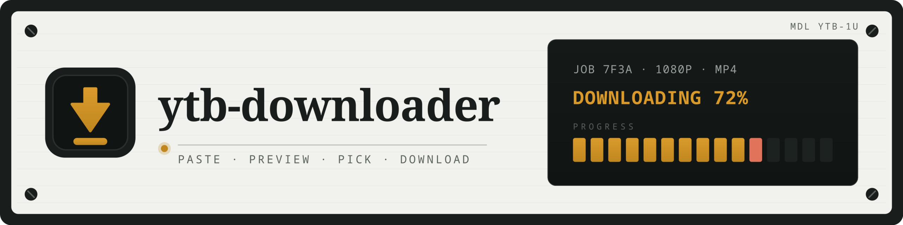

## Prerequisites

- `uv` and Python 3.12 or newer. `backend/pyproject.toml` sets `requires-python = ">=3.12"`.
- Node 20 or newer and `npm` for the Vite frontend.

## Backend (dev run)

```sh
cd backend
uv run uvicorn app.main:app --reload
```

The API listens on `http://localhost:8000`. That host and port are the uvicorn defaults. Check health with `curl http://localhost:8000/api/health`. A healthy server returns `{"status": "ok"}` from `GET /api/health` in `backend/app/main.py`.

## Frontend (dev run)

```sh
cd frontend
npm install
npm run dev
```

Vite serves the app on `http://localhost:5173`. That origin is listed in the backend CORS allow list in `backend/app/main.py`, so keep both servers running. The header reads `connected` when `GET /api/health` succeeds.

## Docker (compose run)

```sh
docker compose up -d --build
```

By default this starts the backend on `http://localhost:8000` and the built frontend (nginx) on `http://localhost:8080`. Host ports are configurable: copy `.env.example` to `.env` (Compose reads it automatically) and set `BACKEND_PORT` and/or `FRONTEND_PORT`.

```sh
cp .env.example .env
# edit .env, e.g. FRONTEND_PORT=3000
docker compose up -d --build
```

The frontend bakes the API URL in at build time. By default it follows `BACKEND_PORT`, so changing the backend port requires a rebuild (`docker compose up -d --build`). Override it with `VITE_API_BASE` when the API is reachable at a different URL:

```sh
VITE_API_BASE=http://localhost:8000 docker compose build frontend
```

Allowed browser origins are configured via `CORS_ORIGINS` (comma-separated). The default includes both `localhost` and `127.0.0.1` on `FRONTEND_PORT`, plus the local Vite dev origin (`5173`).

Downloads persist in the `downloads` Docker volume (`YTB_DOWNLOAD_DIR=/data/downloads` inside the backend container). Stop with `docker compose down`.

## Configuration

Set `YTB_DOWNLOAD_DIR` to choose where finished downloads are stored. It defaults to `./downloads` relative to the working directory that starts the server.

| Variable | Used by | Default |
| --- | --- | --- |
| `YTB_DOWNLOAD_DIR` | Backend (`backend/app/engine.py`) | `./downloads`, relative to the working directory that starts the server |
| `VITE_API_BASE` | Frontend (`frontend/src/api.ts`) | `http://localhost:8000` |
| `BACKEND_PORT` | Docker Compose | `8000` (host port; also the default `VITE_API_BASE` port) |
| `FRONTEND_PORT` | Docker Compose | `8080` (host port; also the default `CORS_ORIGINS` port) |
| `CORS_ORIGINS` | Backend, set by Compose | `http://localhost:8080`, `http://127.0.0.1:8080`, and the Vite dev origin on `5173` |

Example:

```sh
YTB_DOWNLOAD_DIR=/tmp/ytb-downloads uv run uvicorn app.main:app --reload
VITE_API_BASE=http://localhost:8000 npm run dev
```

Run the frontend example from `frontend/`. Run the backend example from `backend/`.

## Checks

Run lint from the repo root:

```sh
npm run lint
```

That script in `package.json` runs the frontend Biome check and the backend Ruff check plus format check.

Backend tests:

```sh
cd backend
uv run pytest
```

Frontend tests:

```sh
cd frontend
npm test
```

That script in `frontend/package.json` runs `vitest run`.

Frontend build:

```sh
cd frontend
npm run build
```

That script in `frontend/package.json` runs `tsc --noEmit && vite build`.
